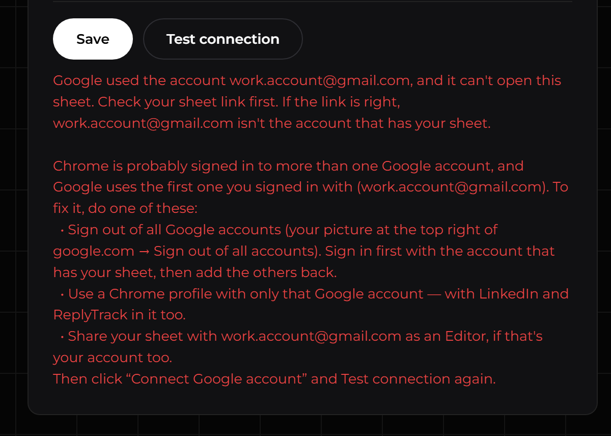

# ReplyTrack — developer notes

The technical side of ReplyTrack: how it's built, what it stores, the rules the sheet script enforces, how to test it, and what to do when LinkedIn changes its pages. Team members only need [README.md](README.md). The team lead's one-time set-up comes first below.

## Contents

- [For the team lead: set up once](#for-the-team-lead-set-up-once)
- [Own script (instead of the team web app)](#own-script-instead-of-the-team-web-app)
- [Helping team members (setup problems)](#helping-team-members-setup-problems)
- [Updating the extension on a member's computer](#updating-the-extension-on-a-members-computer)
- [Files](#files)
- [How it fits together](#how-it-fits-together)
- [The sheet and Code.gs](#the-sheet-and-codegs)
- [Outreach](#outreach)
- [Who accepted](#who-accepted)
- [Reply capture](#reply-capture)
- [Admin Replies and “Already connected” chats](#admin-replies-and-already-connected-chats)
- [The dashboard](#the-dashboard)
- [Messages, alarms and storage](#messages-alarms-and-storage)
- [When LinkedIn changes its pages](#when-linkedin-changes-its-pages)
- [Logs and debugging](#logs-and-debugging)
- [Testing checklist](#testing-checklist)
- [Before you commit](#before-you-commit)
- [Good to know](#good-to-know)

---

## For the team lead: set up once

You set up **one** web app for the whole team, and **one** sheet template. Team members then only make a copy of the template and connect it ([README](README.md)). You need about 15 minutes and the Google account that will own ReplyTrack's script.

### The team web app

1. Go to [script.google.com](https://script.google.com), signed in with the account that will own the script, and click **New project**.
2. Click **Untitled project** at the top and name it **ReplyTrack**. (Team members see this name on Google's permission screen.)
3. Click inside the code, press **Ctrl+A** (Mac: **Cmd+A**), then **Delete**.
4. On the ReplyTrack page on GitHub, open **apps-script → Code.gs**, click **Copy raw file**, and paste it into the editor.
5. Near the top, `TEMPLATE_COPY_URL` holds the template's **Make a copy** link (see [The template](#the-template)). Check it's yours — it's the button members see on the "You're connected" page. Click **Save project** (💾).
6. Click **Deploy → New deployment**, click the ⚙️ gear next to **Select type** and choose **Web app**. Set:
   - **Execute as:** **User accessing the web app**
   - **Who has access:** **Anyone with Google account**

   Click **Deploy**, allow Google's permission screen (**Advanced** → **Go to ReplyTrack (unsafe)** → **Allow**), then copy the **Web app** URL (it ends in **/exec**).
   <!-- TODO screenshot (docs/images/TODO-deploy-team-web-app.png): Deploy dialog with "Execute as: User accessing the web app" and "Who has access: Anyone with Google account" -->

   **Execute as** matters: the web app then runs as each team member, on their own sheet, so it can only reach sheets they can already edit. With "Execute as: Me" it refuses every request.

### The template

The sheet every member copies. Make it once, by hand:

1. A tab named **MY LEADS** with these names in row 1: **LinkedIn Profile**, **Personalized Message**, **Outreach Status**, **Sent Date**, **Response / Notes**, **Admin Reply** (more columns are fine, e.g. Name).
2. An **Outreach Status** dropdown on the rows under the header (**Data → Data validation**) with at least **Not Started**, **Sent** and **Replied**.
3. No leads in it — every member gets a copy of whatever is there.
4. **Share** → under **General access** choose **Anyone with the link** → **Viewer** → **Done**. (Viewers can't change your template; they can only make a copy.)
5. Its **"Make a copy"** link is its address with `/copy` at the end instead of `/edit…`, e.g. `https://docs.google.com/spreadsheets/d/<id>/copy`. Members open it in the README, Step 1.

### Build the links into ReplyTrack

1. In the ReplyTrack files, open **extension/team-config.js**.
2. Paste the **/exec** URL between the quotes after `webAppUrl:`, and the **/copy** link after `templateCopyUrl:`.
3. Put the changed files on GitHub. Team members who download ReplyTrack now get your web app built in, and Settings shows "Make your copy of the template".
4. Send your team the **"Make a copy"** link and the **GitHub** page.

### Updating the team web app

When **Code.gs** changes: paste the new code into the project (steps 3–5), then **Deploy → Manage deployments** → ✏️ → **Version: New version** → **Deploy**. The URL stays the same, so nobody has to change anything. If Google asks you for a new permission, team members will need to click **Connect Google account** once more.

### Team web app: good to know

- **Team members don't need a secret key.** Each request carries their own Google login and runs as them, so it can't reach anything they couldn't edit themselves. Their sheet's link is sent in the request body, never in the address.
- **You don't get access to their sheets.** The script runs as each member, not as you.
- **Keep the owner account safe** (2-step verification), and don't share edit access to the project: whoever can change the script changes what ReplyTrack does for everyone. If that account is closed, ReplyTrack stops for the whole team.
- **"Google hasn't verified this app"** is shown to everyone who approves it the first time. Google also limits how many people can approve an unverified app (100 at the time of writing); a bigger team would need Google's app verification.
- Copies keep the template's time zone (**File → Settings**). Sent Dates and reply times use the sheet's time zone.
- Runs show up under **Executions** in the Apps Script project.

---

## Own script (instead of the team web app)

The other way to connect: put Code.gs **inside your sheet** and deploy it yourself. Use this for a sheet that's synced to a main sheet, or if your team lead asks you to. It needs a **secret key**.

### Set up the script (once)

1. Open your Google Sheet and click **Extensions → Apps Script**. A new tab opens with a code editor.
   If Google says *"Sorry, unable to open the file at this time"*, see [below](#google-says-sorry-unable-to-open-the-file-at-this-time).
2. Click inside the code, press **Ctrl+A** (Mac: **Cmd+A**), then **Delete**.
3. On the ReplyTrack page on GitHub, open **apps-script → Code.gs**, click **Copy raw file**, and paste it into the editor.
4. Make up your **secret key**: 16 or more letters, numbers and dashes — for example from a password generator. Write it down somewhere safe. (It's like a password for your sheet: ReplyTrack sends it with every request, and your sheet ignores any request without it. Don't share it.)
5. Near the top of the code, find `var SECRET_KEY = 'CHANGE-ME';` and replace **CHANGE-ME** with your key. Keep the quote marks.
6. Click **Save project** (💾).
7. In the list next to **Debug**, choose **testSetup** and click **▶ Run**. Google asks for permission: **Review permissions** → your account → **Advanced** → **Go to … (unsafe)** → **Allow** (tick all boxes first, if there are any).
8. The **Execution log** should say **Secret key: set**, and the **MY LEADS** line should list your rows and columns. If it says **missing column**, fix that column name in row 1 and run **testSetup** again.
9. Click **Deploy → New deployment** → ⚙️ → **Web app**. Set **Execute as: Me** and **Who has access: Anyone**. (If **Anyone** isn't in the list, choose **Anyone within** your company, and tick **Send my Google login with each request** in Settings later.)
10. Click **Deploy** (allow again if asked), then copy the **Web app** URL that ends in **/exec**.

### Connect

1. In ReplyTrack, open **Settings** and click **Advanced**.
2. Tick **Use my sheet's own script instead**.
3. Paste the **/exec** URL into **Your script's web app URL** and your key into **Secret key**. Check **Tab name**.
4. Click **Save**. The message should be green and start with **Connected**.

(If you set ReplyTrack up before version 2.2, this is already how you're connected — nothing to change.)

### Updating your own script

Only when the update notes say **Code.gs changed**:

1. Open your sheet → **Extensions → Apps Script**.
2. Replace all the code with the new Code.gs, and put your secret key back into the `SECRET_KEY` line — the same key as before.
3. Click **Save project** (💾). Run **testSetup** once; if Google asks for a new permission, allow it.
4. Click **Deploy → Manage deployments** → ✏️ → **Version: New version** → **Deploy**.
   <!-- TODO screenshot (docs/images/TODO-manage-deployments-new-version.png): "Manage deployments" with the pencil clicked and "Version: New version" selected -->

The web app address stays the same, so you don't need to change anything in Settings.

### Problems with your own script

| The message says | What to do |
|---|---|
| The secret key doesn't match SECRET_KEY in your Code.gs | Use the same key in Settings and in Code.gs. If you changed it in Code.gs, deploy a new version ([Updating your own script](#updating-your-own-script), step 4). |
| Your Code.gs isn't ready: set SECRET_KEY in Code.gs | You didn't replace **CHANGE-ME** yet (step 5), or didn't deploy after saving. |
| … SECRET_KEY in Code.gs is too short | Use a key with 16 or more characters. |
| Apps Script returned a web page instead of an answer | In the deployment, **Who has access** must be **Anyone**, and the address must end in **/exec**. |
| That's a test (/dev) URL | Use the address from **Deploy** that ends in **/exec**. |
| unexpected answer … is the NEW Code.gs deployed? | Your sheet still has an old script. Paste the new Code.gs and deploy a new version. |

#### Google says "Sorry, unable to open the file at this time"

This happens when Chrome is signed in to several Google accounts at once.

1. Open an Incognito window: press **Ctrl+Shift+N** (Mac: **Cmd+Shift+N**).
2. Go to **sheets.google.com** and sign in with only the Google account that owns your sheet.
3. Open your sheet, then click **Extensions → Apps Script** and continue.

You only need Incognito for setting up the script. Use ReplyTrack in your normal Chrome window.

---

## Helping team members (setup problems)

### Wrong Google account

When Chrome is signed in to **more than one Google account**, Google uses the **first one you signed in with** — not always the one that has your sheet. You'll see *Google used the account … and it can't open this sheet*, or *Connected as …* shows the wrong account, or Google keeps asking for your OK after you already clicked **Connect Google account**.

Do **one** of these:

- **Make your sheet's account the first one:** open google.com, click your picture at the top right → **Sign out of all accounts**. Sign in again with the account that has your sheet **first**, then add your other accounts.
- **Use a separate Chrome profile** with only that Google account: click your picture at the top right of Chrome → **Add**. Sign in to that Google account and to LinkedIn there, and install ReplyTrack there (README, Step 2).
- **Share your sheet** with the account Google uses, as an **Editor** — only if that's your account too.

Then click **Connect Google account** in Settings (approve it if Google asks), and **Save**.



### The message under Save shows a problem

| The message says | What to do |
|---|---|
| Your sheet has no tab called "…" | Check **Tab name**. It must match your tab exactly — spaces count. |
| Row 1 of "…" has no "…" column | A column name in row 1 was changed or deleted. Put it back exactly as written. |
| That doesn't look like a Google Sheets link | Open your sheet and copy the address again (README, Step 1, step 6). |
| Google needs your OK first | Click **Connect Google account** and approve ReplyTrack (README, Step 3, steps 4–8). |
| … but you already clicked "Connect Google account" | See [Wrong Google account](#wrong-google-account). |
| Google used the account … and it can't open this sheet | Check **Your sheet link**. If it's right, see [Wrong Google account](#wrong-google-account). |
| … can open your sheet but not edit it | See [Wrong Google account](#wrong-google-account). |
| You're not signed in to Google in this Chrome | Sign in to Google with the account that has your sheet, then click **Connect Google account**. |
| The team web app isn't deployed the right way, or its URL isn't set | Tell your team lead. |
| ⚠ "Sent" isn't in the dropdown | Tell your team lead. |
| ℹ No … column | Not a problem — that column isn't in your sheet, so the feature named in the line is off. |
| Problem: could not reach Apps Script | Check your internet connection and click **Test connection**. |

### The pill says "Not set up"


ReplyTrack doesn't have your settings yet. Do [Step 3 of the README](README.md#step-3--connect-it).

---

## Updating the extension on a member's computer

1. Download the new ZIP from GitHub and extract it (README, Step 2, steps 1–2).
2. Open your **existing** ReplyTrack folder — the one you loaded in README Step 2 — and replace everything in it with the files from the new folder. Keep the folder in the same place, with the same name. (If it moves, Chrome treats it as a new extension and your settings and history are lost.)
3. Go to `chrome://extensions`.
4. On **ReplyTrack**, click the **↻** reload icon.

Your settings and history are kept. Never click **Remove** on ReplyTrack — that deletes its history (for example, who already got a request).

✅ **It worked if** the pill says **Active** and **Settings → Test connection** says *Connected*.

---

## Files

```
replytrack/
├── README.md              ← for team members (set-up and daily use)
├── DEVELOPER.md           ← this file
├── docs/images/           ← README screenshots (made with sample data only)
├── apps-script/
│   └── Code.gs            ← the team web app (its own project, deployed once) — or a member's own script inside their sheet
└── extension/             ← the Chrome extension (Manifest V3; load this folder)
    ├── manifest.json
    ├── team-config.js     ← the team web app URL and the template's /copy link (filled in by the team lead)
    ├── background.js      ← the one service worker: importScripts() the parts in bg/, one message router
    ├── bg/
    │   ├── common.js      ← helpers, the [Outreach] / [ReplySync] logs, recent activity
    │   ├── sheet.js       ← the member's sheet: Code.gs calls (team web app or own script), write outbox
    │   ├── lock.js        ← one thing at a time on LinkedIn
    │   ├── linkedin.js    ← the minimized worker window/tab where outreach.js runs
    │   ├── outreach.js    ← connection requests from the sheet's rows
    │   ├── replysync.js   ← the pinned messaging tab, replies → Response / Notes
    │   ├── accepted.js    ← twice a day: who accepted
    │   ├── admin.js       ← the “To send” list, sending one message, verifying it
    │   └── control.js     ← Pause everything / Start again
    ├── outreach.js        ← injected ONLY into the worker tab: Voyager API calls (profile, invite, message, connections)
    ├── content.js         ← content script on linkedin.com/messaging/*: reads conversations (CONFIG selectors at the top)
    ├── shared.js          ← sheet column names (required / optional), the connection settings, placeholders and the note, defaults, CSV helpers
    ├── dashboard.html / dashboard.css   ← the dashboard (the toolbar icon opens it as a tab)
    ├── dash/              ← the dashboard's scripts: theme, core, overview, outreach, replies, tosend, settings
    ├── fonts/             ← Montserrat + JetBrains Mono (woff2) and their SIL Open Font License files
    └── icons/             ← 16 / 32 / 48 / 128 px
```

---

## How it fits together

- **One service worker** (`background.js`) loads `shared.js` and `bg/*.js` with `importScripts()`. Each `bg/` file is one module (`const Sheet = (() => { … })()` and so on), so names don't collide in the shared global scope. One `chrome.runtime.onMessage` listener routes every message; types it doesn't know get no answer (they're meant for a tab).
- **The member's sheet** is reached only through Code.gs (`bg/sheet.js`): the team web app (default) or the member's own script (see [The sheet and Code.gs](#the-sheet-and-codegs)). Reads are immediate. Writes go through an **outbox** in `storage.local` and are retried every minute, in order, until they go through. Only sheet writes are ever retried — never anything on LinkedIn.
- **The lock** (`bg/lock.js`, kept in `storage.session`) makes sure only one of these touches LinkedIn at a time: `outreach` (a run or dry run, for the whole run), `replysync`, `accepted`, `admin` (sending one message) and `adminCheck` (connection look-ups for the To send list). An Admin Reply waiting goes first; otherwise first come, first served. A holder that stops beating for 3 minutes loses it. When the lock is released, a reply sync or accepted check that had to wait runs.
- **The worker tab** (`bg/linkedin.js`): one minimized window with an about:blank tab and a LinkedIn tab. `outreach.js` is injected there (isolated world) and calls LinkedIn's Voyager API with same-origin `fetch()` — the user's cookies and CSRF token. LinkedIn's own `x-li-*` headers are read from the tab's requests with `chrome.webRequest`. Calls are never retried for `OR_INVITE` and `OR_MESSAGE` (they may have gone through).
- **The pinned messaging tab** (`bg/replysync.js` + `content.js`): reloaded every 20 minutes (and 30 s after the computer wakes up); each load makes `content.js` ask `shouldSync`, take the lock, and walk the newest conversations.
- **The dashboard** (`dashboard.html` + `dash/*.js`) reads `chrome.storage` and sends messages to the service worker; it never talks to LinkedIn or the sheet itself.

---

## The sheet and Code.gs

Each team member has their **own Google Sheet file** — a copy of the team template, or (for the original team) a sheet synced with the main sheet the managers read. ReplyTrack only reads and writes **that** sheet, and only the tab named in its settings (e.g. `MY LEADS`). Columns are found **by their header in row 1** (case and extra spaces ignored), never by position.

| Column | Needed? | What ReplyTrack does |
|---|---|---|
| LinkedIn Profile | required | reads (`https://www.linkedin.com/in/...`; the URL behind link text or inside `=HYPERLINK()` also works) |
| Personalized Message | required | reads — the connection note / chat message |
| Outreach Status | required | writes **Sent** (only from empty or *Not Started*) and **Replied** (only from *Sent*) |
| Sent Date | optional | writes the date a request was sent (a real date, `dd mmm yyyy`); left empty when that date isn't known; a hand-typed Sent Date is kept. Missing → not written; the accepted check is off |
| Response / Notes | optional | writes their replies, and “Accepted but not replied”. Missing → replies only change Sent → Replied (text not saved); the accepted check is off; Admin Replies show no “latest message” and clear only Admin Reply |
| Admin Reply | optional | reads; **cleared** (with Response / Notes) only after an Admin Reply was seen in the LinkedIn conversation. Missing → no Admin replies in To send (Already connected still works) |
| Team Member | — | read only — the dashboard's “Welcome back, …” |
| every other column | — | read only (for `{placeholders}`) — never written: Batch ID, Campaign, Name, Company Name, Source Tab, Source Row, Allotted On, Allotment #, … |

Columns are never added. `ping` and `read` return `missing` (the optional columns not found); the extension also works it out from the header (`S.missingColumns`) to show “Off — …” on the affected cards.

### Two set-ups — decided by where Code.gs lives

| | Team web app (default) | Own script |
|---|---|---|
| Where | its own Apps Script project (script.google.com → New project) | inside the member's sheet (Extensions → Apps Script) |
| Deployed | once, by the team lead: **Execute as: User accessing the web app**, **Anyone with Google account** | by the sheet's owner: **Execute as: Me**, **Anyone** |
| Which sheet | `SpreadsheetApp.openById(<sheet>)` — the id the extension sends | `getActiveSpreadsheet()` — only the sheet it's in; any `sheet` in the request is ignored |
| Who it runs as | the member sending the request (their Google login: the extension uses `credentials: "include"`) | the owner |
| Access check | `Session.getEffectiveUser()` must equal `Session.getActiveUser()` — otherwise (deployed “Execute as: Me”) every request is refused with `not running as you …` | `SECRET_KEY` (16+ characters, not `CHANGE-ME`) |
| Write lock | `LockService.getUserLock()` (per member) | `LockService.getScriptLock()` |
| `doGet` | the “You're connected” page (HtmlService), showing the account | “ok — ReplyTrack web app is running” |
| Answers | include `account` (the Google account it ran as) | — |

`SpreadsheetApp.getActiveSpreadsheet()` returns `null` in a standalone project — that's how Code.gs tells the two apart.

**No key in the team web app**, on purpose: each request runs as the caller, so it can only reach sheets the caller can already edit — a key would add nothing against them, and a team-wide key would sit in every member's extension anyway. A cross-site page could at most try to trigger a write (the browser keeps it from reading the answer), and only if it knew the member's sheet id; the possible writes are the narrow ones below. The sheet id travels in the POST body, never in the URL.

**Scopes:** `spreadsheets` (needed for `openById`; Google's screen says “all your spreadsheets”) and `userinfo.email` (for `Session…getEmail()`). An own script that's updated to this Code.gs asks for the email permission once.

### Code.gs actions

Every request is a POST with a JSON body — team web app: `{ "sheet": "<spreadsheet id>", "tab": "MY LEADS", "action": "…", … }`; own script: `{ "key": "<SECRET_KEY>", "tab": "MY LEADS", "action": "…", … }`. A request that fails the access check is rejected before anything is read.

| Action | Does |
|---|---|
| `ping` | checks the tab, the required columns, the Outreach Status dropdown, formula-filled columns and protections; `rows` = rows with a LinkedIn Profile; `missing` |
| `read` | every row, all columns as displayed (the profile column holds the link itself), Sent Dates as ms (all `null` without a Sent Date column), the dropdown values, `missing` |
| `markSent { profileUrl, sentAt }` | “Sent” + Sent Date (the day of `sentAt`; no `sentAt` or no Sent Date column → only the status) in every row of that person whose status is empty / Not Started |
| `markAccepted { profileUrl }` | “Accepted but not replied” where status is Sent and Response / Notes is empty (no Response / Notes column → `{ ok: true, off }`, nothing written) |
| `addReplies { profileUrl, replies, sentAt }` | their messages into Response / Notes; Sent → Replied (no Response / Notes column → only Sent → Replied, `statusOnly: true`) |
| `clearAdmin { profileUrl, row, adminText, notesText }` | after a verified Admin Reply: clears Admin Reply and Response / Notes in that row (contents only; no Response / Notes column → Admin Reply only) |

Answers are JSON: `{ ok: true, … }` or `{ ok: false, error }` with errors such as `wrong key`, `set SECRET_KEY in Code.gs`, `tab not found`, `missing column: <name>` (required columns only), `profile not in tab`, `cell full`, `admin reply changed — not cleared`, `no "Admin Reply" column`, `bad request`, `busy, try again`, `error: …`; team web app only: `no sheet link`, `no access to sheet` (`openById` failed — wrong link or wrong account), `no edit access to sheet: …` (a write failed with a permission error), `not running as you — …`.

### The template, the copy button and testSetup()

- The template is a sheet the team lead made by hand (MY LEADS tab, the columns, the Outreach Status dropdown, no leads), shared as *Anyone with the link → Viewer*. Its `/copy` link is in `TEMPLATE_COPY_URL` (Code.gs — the **Make a copy of the sheet** button on the “You're connected” page) and in `team-config.js` (`templateCopyUrl` — the link in Settings).
- The Outreach Status dropdown is looked for in row 2 even when the tab has no rows yet, so an empty copy passes Test connection.
- The extension treats a row whose only content is an empty / Not Started status as empty (not a lead, no “no link” warning).
- `testSetup()` — read-only, for an own script: the key status, the time zone and, per tab, the rows, the missing optional columns, the dropdown and any problems. In the team project it only says there's nothing to test there.

### The extension side (bg/sheet.js)

`S.connection(storage.sync)` → `{ mode, tabName, sheetId, url, secretKey, googleLogin }`. `mode` is `"team"` or `"own"`; settings saved before 2.2 (no `mode`, but a URL and a key) are `"own"`, so existing members keep their own script with no change. The team web app URL is `teamUrl` (Settings → Advanced) or else `RT_TEAM.webAppUrl` from `team-config.js`. An empty tab name means `MY LEADS`.

Google's answers are turned into a `code` (kept in `rtSheetError` for the banner; Settings → Test connection explains each in full):

| code | When |
|---|---|
| `signin` | the request ended on `accounts.google.com` (not signed in to Google) — hence the `accounts.google.com` host permission |
| `consent` | an HTML page mentioning authorization / permission: the account Google used hasn't approved the web app. If “Connect Google account” was clicked before (`rtConnectAt`), Settings says Google is probably using another account |
| `account` | “Sorry, unable to open the file” — Google wouldn't open the web app for that account |
| `noaccess` / `noedit` | Code.gs couldn't open / write the sheet as `account` |
| `deploy` | `not running as you` |

**Several Google accounts:** Google runs the web app as the browser's **first** signed-in account (there's no reliable way to pick another one from the extension). Every team answer carries `account`; Test connection shows “Connected as …”, Settings shows the last account used (`rtAccount`), and the wrong-account messages give three fixes: sign in with that account first, a Chrome profile with only that account, or share the sheet with the account Google uses.

### Rules Code.gs enforces, whatever the extension asks

- Only Outreach Status, Sent Date, Response / Notes and Admin Reply are ever written; Admin Reply is only ever cleared.
- Outreach Status only ever gets “Sent” or “Replied”, and only if that value is in the cell's dropdown (its own rule, else the column's). Never “Bounced”, never anything else.
- A cell with a **formula** is never written — it's skipped and logged. A column filled by one formula at the top (ARRAYFORMULA, IMPORTRANGE, QUERY, FILTER, …) is never written at all.
- Text in Response / Notes is never deleted or overwritten — new replies are added below it, keeping the existing text and its formatting. Exceptions: the exact text “Accepted but not replied” (replaced by the first reply), and the clear after a verified Admin Reply (replies that arrived after the extension read the cell are kept).
- Clearing removes contents only — formatting and dropdowns stay. Columns are never added, removed or moved.
- Rows are matched by the LinkedIn Profile link (case, `www`, trailing `/`, `?…` and URL encoding don't matter). The same person in two rows → both rows are updated.
- Dates and reply times use the spreadsheet's time zone (**File → Settings**), `Asia/Kolkata` if none is set. Reply format: `[27 Oct 2026, 11:42 PM] text`, oldest first, a blank line between messages, never twice.
**Changing Code.gs later:** **Deploy → Manage deployments → ✏️ → Version: New version → Deploy** keeps the same URL. (“New deployment” makes a new URL.) Editing the code without deploying a new version doesn't change what the web app runs. For the team web app, one new version updates everyone at once; if it needs a new scope, every member has to click **Connect Google account** again.

---

## Outreach

- Rows are read from the sheet at every **Start** and with **Reload rows from sheet**.
- A request is only sent to rows whose **Outreach Status is empty or “Not Started”** and that have **both** a LinkedIn Profile and a Personalized Message. Any other status (Sent, Drafted, Replied, Meeting Booked, Follow-up, Not Interested, Bounced) is never touched — and if another row for the same person has such a status, that person isn't touched either.
- After a request is sent: **Sent** + today's **Sent Date**. No request is sent, but the row still gets **Sent**, when:
  - this extension already sent that person a request (its history `h:<key>`, imported history included) → Sent Date = the date it was sent then (left empty if the history has no date);
  - LinkedIn shows a request already pending → Sent Date left empty.
- Already a 1st-degree connection → no request possible; the person is recorded in `adConnected` and listed in **To send → Already connected** (see below).
- Other skipped rows and failed rows keep their status; the reason shows in the extension only. A row skipped because of its note waits again as soon as the row (or the typed note) changes.
- Pace (defaults, Settings → Outreach): wait 4–10 s on each profile, 5–10 s before the next, 3–6 s after a skipped row, a 1–3 minute break about every 25 requests, auto-stop at 500 a day (Continue sends another day's worth). The first 3 requests of a run and ~1 in 20 after are checked on LinkedIn (the profile must show the request as pending, else the run stops). Unclear answers are counted and re-checked on Continue. Automatic stops: signed out, “too many requests” (429/999), LinkedIn's invitation limit, note refused, 5 errors in a row.
- **Dry run** looks every waiting row up and says what would happen — sends nothing, writes nothing.
- Everyone this extension sent a request to is remembered **forever** (`h:<key>`); **Import sent history** adds the old extension's history (a missing date = “sent, date unknown”).
- Placeholders: `{Name}`, `{Company Name}` — any column — plus `{firstName}`, `{lastName}`, `{fullName}`, `{headline}` from the profile. Keys match ignoring case, spaces and punctuation. A placeholder with nothing to fill it, or a note over 300 characters, skips the row.
- **Self-repair:** when the user sends a connection request **with a note** by hand in any LinkedIn tab, the page's own request is learned (via `chrome.webRequest`) and tried first (`orTplInvite`); after 3 failures the built-in one is used again.

## Who accepted

Twice a day — around 10 AM and 4 PM local time, or the next time Chrome is open after that (checked by the 15-minute `rt-tick` alarm) — rows with Outreach Status **Sent**, an empty Response / Notes and a Sent Date in the last **30 days** are compared with the user's **recently added connections** (a few paged requests, sorted by RECENTLY_ADDED, not one per row). Matches get “Accepted but not replied”. Rows without a Sent Date aren't checked. **Check now** in the Outreach tab runs it at once. Waits for the lock; off while paused.

## Reply capture

- Every 20 minutes (`replysync-reload`), 30 s after the computer is active again (`replysync-wake`), and 1 minute after a failure for lack of internet (`replysync-retry`), the pinned messaging tab is reloaded and `content.js` goes through the newest conversations at a human pace (2–5 s between conversations). The first sync checks the 50 most recent conversations; later ones go back to the last sync (10-minute overlap), at most 200.
- Only **the other person's** messages are taken (`--other` class, sender link or name). `/in/ACoAA…` links are turned into vanity links (profile API → page HTML → a background tab; cached in `vanityCache`).
- Group conversations and sponsored / InMail threads are skipped. A conversation is only written if that person is in the tab (`profile not in tab` otherwise).
- Never twice: `sentHashes` per conversation and text; Code.gs also checks the entries already in the cell.
- Admin Replies: a message whose text is one of the Admin Replies or chats sent to that person (`adHistory`) is never taken as their reply. After an Admin Reply (which clears Response / Notes), only their messages **after** that reply count — by position in the conversation, else by LinkedIn's time. Chats don't start a new “since” (they don't clear the cell).
- Status Sent → Replied (no other status changes). The dashboard's “Replies today” (`rsToday`) and “Latest replies” (`rsRecent`) are updated.

## Admin Replies and “Already connected” chats

**Admin replies:** rows whose Admin Reply has text not sent (or skipped) before. **Already connected:** rows still empty / Not Started whose person an outreach run found already connected; the message is the row's Personalized Message with placeholders filled (Send stays disabled while one is unfilled).

**Send** (after the user confirms “Send this message to <Name>?”; one at a time, never automatic):

1. Wait for the lock (Cancel works until the message goes out).
2. Look the row's own LinkedIn Profile up — it must be 1st-degree (else “Not connected yet — LinkedIn only allows messages to connections”).
3. Open the conversation (known from the reply sync, `rsThreads`, else LinkedIn's participants lookup) in the worker tab: if the user already sent this exact text there → “This message is already in the conversation” → **Mark as sent**.
4. A human pause (`readMin`–`readMax`), then the text goes into `adHistory` as “unconfirmed” (write-ahead) and **one** message is sent (`OR_MESSAGE`). Another request shape is tried only when LinkedIn clearly rejected the previous one's format (HTTP 400/404/405/410/415/422 — nothing was sent then). Never retried otherwise.
5. Read the conversation back (`RT_READ_THREAD`, the same selectors as reply capture). Only a message seen there counts → history “sent”, then:
   - Admin Reply: `clearAdmin` (Admin Reply + Response / Notes cleared);
   - chat: `markSent` with today's date (Sent Date left empty for “Mark as sent” / “Already sent by hand”); nothing cleared.
   Not seen / unclear answer → “Couldn't confirm — check the conversation on LinkedIn” → **It was sent** / **It wasn't sent**. If the extension restarts mid-send the job becomes “Couldn't confirm”.

- **Never the same text twice** to the same person: `adHistory` is per person and never expires; a text in it can't be sent again and doesn't show in the list again (e.g. if the sheet sync copies a cleared Admin Reply back). An edited text also retires the original.
- **Skip** hides an item until its text changes (`adSkipped`). **Already sent by hand** records it without sending (Admin Reply: cells cleared; chat: Sent with no Sent Date).
- Connection status for the list is looked up in the background (`adminCheck`, a few at a time, at the normal pace).
- **Self-repair:** a message sent by hand in any LinkedIn tab teaches the current message request (`orTplMessage`, the text replaced by a placeholder; templates that still name a conversation or person are discarded).

---

## The dashboard

- The toolbar icon opens `dashboard.html` as a tab, or switches to it if it's open (`chrome.runtime.getContexts`). `#overview`, `#outreach`, `#replies`, `#tosend`, `#settings` select the tab (the sections' ids are `page-…` so the hash doesn't scroll the page). `options_ui` also points at it.
- `dash/core.js` holds the shared state (`chrome.storage` snapshot), top bar, banner, tabs and theme; each section registers `onRender()` (every storage change and once a second) and `onChange()` (heavy work only when its data changes).
- **Status pill:** green **Active** (automatic reply syncing on, outreach not stopped part-way), amber **Partly paused** (reply sync stopped, or an outreach run stopped with rows still waiting), grey **Paused** (only after Pause everything), grey **Not set up** (no settings yet).
- **Banner** (only when action is needed): Not set up yet · LinkedIn logged out — sign in again · Daily invite limit reached — press Continue tomorrow · Can't reach your sheet — check settings (or, by `rtSheetError.code`: Sign in to Google · Google needs your OK · Wrong Google account · The team web app isn't set up right).
- **Badge:** the number of To send items (`Admin.rebuild()`).
- Settings → Connection: **Your sheet link**, **Tab name** (MY LEADS by default), **Connect Google account** (opens the team web app in a tab; sets `rtConnectAt`), and **Advanced**: the team web app URL (built in; “Reset to default”) and **Use my sheet's own script instead** (URL, secret key, Google login box). Only the chosen set-up's fields show (`#connCard.own`). The fields save with **Save** (which also tests); unsaved changes show a bottom bar with Save / Discard. Outreach settings save as you type.
- Missing optional columns: the Who accepted card says “Off — …” (Check now disabled), To send says “Admin replies are off”, Replies explains that reply text isn't saved — from the last header read (`adRows` / `orSheet`).
- Theme: dark by default; the choice is kept in the page's `localStorage` (`rtTheme`). Fonts are bundled (SIL OFL 1.1, licence files in `fonts/`); nothing is loaded from the internet.

---

## Messages, alarms and storage

**Messages to the service worker:** `OR_START`, `OR_STOP`, `OR_LOAD`, `OR_COUNTS`, `OR_IMPORT`, `AC_CHECK`, `AD_REFRESH`, `AD_SEND`, `AD_CANCEL`, `AD_SKIP`, `AD_BY_HAND`, `AD_UNCLEAR`, `RT_PAUSE`, `RT_RESUME`, and from the reply sync / settings: `sleep`, `shouldSync`, `syncStarted`, `syncProgress`, `syncFinished`, `resolveProfile`, `cacheVanity`, `postConversation`, `loggedOut`, `syncNow`, `testConnection`, `resetHistory`, `settingsSaved`, `stopSync`, `startSync`.

**Messages to tabs:** worker tab (`outreach.js`): `OR_PING`, `OR_ME`, `OR_PROFILE`, `OR_INVITE`, `OR_VERIFY`, `OR_CONNECTIONS`, `OR_FIND_THREAD`, `OR_MESSAGE`. Messaging pages (`content.js`): `RT_PING`, `RT_READ_THREAD`, `stopSync`.

**Alarms:** `replysync-reload` (20 min), `replysync-wake`, `replysync-retry`, `rt-tick` (15 min: accepted check due? outbox), `rt-outbox` (1 min while sheet writes wait).

**storage.sync:** `mode` (`team` | `own`; absent = worked out, see above), `tabName`, `sheetUrl`, `teamUrl` (`""` = the built-in one), `scriptUrl`, `secretKey`, `useGoogleLogin`.

**storage.local:**

| Area | Keys |
|---|---|
| Outreach | `orSheet`, `orItems`, `orSettings`, `orRun`, `orCounts`, `h:<person>` (sent history, forever), `orHeaders`, `orTplInvite`, `orMe`, `orLog` |
| Reply sync | `rsStatus`, `lastSync`, `sentHashes`, `vanityCache`, `syncTabId`, `loggedOutNotifiedAt`, `syncStopped`, `rsPending`, `rsToday`, `rsThreads`, `rsRecent`, `rsLog` |
| Accepted | `acStatus`, `acWeek` |
| To send | `adRows`, `adList`, `adConnected`, `adHistory` (forever), `adSkipped`, `adJob`, `adNote`, `adDegree`, `orTplMessage` |
| Sheet | `rtOutbox`, `rtSheetError` (`{ at, error, code, account }`), `rtAccount` (`{ email, at }`), `rtConnectAt` |
| Everything | `rtPaused`, `rtLoggedOut`, `rtActivity`, `rtMember` |

**storage.session:** `rtLock`, `orWorkerWindowId`, `orWorkerTabId`, `orSession`.

Everything is stored in this Chrome profile only. An unpacked extension's id comes from its folder path — moving the folder (or removing the extension) loses all of it.

---

## When LinkedIn changes its pages

All messaging-page selectors are in the **`CONFIG`** block at the top of `extension/content.js`. Each entry is a list of CSS selectors tried in order.

1. Open `linkedin.com/messaging` in a normal tab.
2. Right-click the part that's no longer found → **Inspect**.
3. Find something stable: a readable `msg-…` class, an `aria-label`, a `data-…` attribute, or a link pattern (`href*="/in/"`). Avoid generated classes like `ember123`.
4. Test it in the Console: `document.querySelectorAll('YOUR SELECTOR').length`.
5. Add it to the **front** of the right list and keep the old ones after it.
6. Save, click ↻ on ReplyTrack in `chrome://extensions`, then **Sync now**. **Settings → Data → Reset sync history** re-checks the last 50 conversations (nothing is duplicated).

| CONFIG entry | Finds |
|---|---|
| `conversationList`, `conversationItem` | the list of conversations and each one |
| `clickTarget` | what gets clicked to open a conversation |
| `itemName`, `itemTime` | name and last-activity time on each conversation |
| `threadTitleBar`, `threadProfileLink`, `threadName` | the bar above an open conversation, with the profile link |
| `messageList`, `messageEvent`, `messageItem`, `messageBody` | the messages and their text |
| `otherPersonMessage`, `senderLink`, `senderName` | their messages vs yours |
| `dateHeading`, `messageTime` | when each message was sent (else the capture time is used and the console says so) |
| `itemSponsoredLabel`, `itemGroupMarker` | what gets skipped |

The Voyager endpoints (profile, invitation, messaging, connections) are in `extension/outreach.js`; both the invite and the message request repair themselves from a manual send (see above).

## Logs and debugging

- Dashboard: **Outreach → Log**, **Replies → Details**, **To send → Details** (the last log lines and the technical numbers).
- Service worker: `chrome://extensions` → ReplyTrack → **service worker** → Console; filter `[Outreach]` or `[ReplySync]`.
- Each conversation of a sync is logged in the pinned tab's own console (F12).
- The sheet script logs to **Apps Script → Executions** (for the team web app: the team lead's project; each run is listed under the member it ran as).

---

## Testing checklist

Use a **copy of the template** (or of your sheet) first and a colleague's LinkedIn account as the “other person”. Then switch the settings to your real sheet.

**Team web app and template** (once, by the team lead)
- [ ] Open the web app URL → “You're connected” with your account and a **Make a copy of the sheet** button that opens the template's copy page.
- [ ] Deploy with **Execute as: User accessing the web app**, **Anyone with Google account**; fill in `team-config.js`; reload the extension.
- [ ] Deploy a second time with **Execute as: Me** → Test connection says the team web app isn't deployed the right way. Remove that deployment.

**Set-up (team web app)**
- [ ] A fresh install opens Settings: Tab name says MY LEADS, “Make your copy of the template” opens the /copy page, Advanced shows the built-in URL.
- [ ] Open the /copy link → Make a copy → paste its link → **Connect Google account** → “Google hasn't verified this app” → Advanced → Go to ReplyTrack (unsafe) → Allow → “You're connected” with your account.
- [ ] **Save** → “Connected as <your account>”, your tab, “0 rows with a LinkedIn Profile” on an empty copy, no ⚠ lines.
- [ ] Before clicking Connect (another Google account that never approved): Test connection says Google needs your OK.
- [ ] A link to a sheet your account can't open → “Google used the account … and it can't open this sheet”; the banner says Wrong Google account.
- [ ] Two Google accounts in Chrome, the sheet in the **second** one → Test connection names the first account and explains the fixes. Sign out of all accounts, sign in with the sheet's account first → Connect → Test → Connected.
- [ ] Signed out of Google entirely → “You're not signed in to Google in this Chrome”.
- [ ] Delete the **Admin Reply** column in the copy → Test connection: ℹ “No Admin Reply column — admin replies are off…”; To send says “Admin replies are off”. Delete **Response / Notes** → a reply changes Sent → Replied, no text; Who accepted says “Off — …”. Delete **Sent Date** → a request gets Sent, no date. Delete **Personalized Message** → Test connection: Row 1 … has no “Personalized Message” column. Put the columns back.

**Set-up (own script)**
- [ ] Settings saved before 2.2 open on Advanced → **Use my sheet's own script instead** ticked, URL and key filled, no unsaved-changes bar; Test connection says “Connected”.
- [ ] Change one character of the secret key → Test connection says the key doesn't match. Put it back.

**Dashboard**
- [ ] Click the ReplyTrack icon → the dashboard opens in a tab; click it again → Chrome switches to that tab (no second one). Green **Active**, no banner; Overview shows your name if the Team Member column has it.
- [ ] ☀ → light theme; reload the page → it stays light.
- [ ] Edit a Connection field → the “unsaved changes” bar appears; **Discard** → the saved values are back.

**Outreach**
- [ ] Add a row: colleague's profile (not yet connected), a Personalized Message with `{Name}`, Outreach Status empty. Add a second row with status **Bounced** and a third with **Sent**.
- [ ] Outreach tab → **Reload rows from sheet**: 1 person waiting; the preview shows the note with the name filled in.
- [ ] **Dry run**: the row says “would send the request…”. Nothing changes in the sheet.
- [ ] **Start** → confirm. Within a minute: the request is on LinkedIn, the row says **Sent** and today's **Sent Date**. The Bounced and Sent rows didn't change.
- [ ] Start again → “No rows are waiting”. Set the row back to *Not Started* and clear its Sent Date → Start → no request is sent, and the row gets **Sent** again with the **original** Sent Date.
- [ ] A row for someone you sent a request to by hand (still pending) → Start → no request, the row gets **Sent** and the Sent Date stays **empty**.
- [ ] Export CSV downloads your rows with the result columns.

**Who accepted**
- [ ] Colleague accepts. Outreach tab → **Who accepted → Check now** → the row's Response / Notes says **Accepted but not replied** (only if it was empty).

**Reply capture**
- [ ] Colleague sends “Test reply 1”. Replies → **Sync now**. It shows under *Latest replies* and in Overview's recent activity. Response / Notes: `[28 Oct 2026, 3:12 PM] Test reply 1` (the “Accepted…” text replaced); Outreach Status **Replied**.
- [ ] Type a note by hand under it in the cell, colleague sends “Test reply 2”, Sync now → your note is still there, the new reply is below it.
- [ ] Sync now again without new messages → nothing changes. Colleague re-sends “Test reply 1” → not added twice.
- [ ] While an outreach run is going, press Sync now → “Waiting for outreach to finish” → it syncs right after the run.

**Admin Replies**
- [ ] Write “Admin test 1” in that row's Admin Reply. Dashboard → **To send** (the icon's badge shows 1): name, their latest message, the text.
- [ ] **Send** → confirm. The colleague receives it **once**; Admin Reply and Response / Notes are cleared in that row.
- [ ] Put “Admin test 1” back into Admin Reply → it doesn't show up again.
- [ ] Write “Admin test 2”, edit the text in the box, Send → the edited text arrives.
- [ ] Send “Admin test 3” **by hand** on LinkedIn, then write the same text into Admin Reply → Send → “This message is already in the conversation” → **Mark as sent** → nothing sent, cells cleared.
- [ ] Admin Reply for someone you're not connected with → Send is greyed out: “Not connected yet — LinkedIn only allows messages to connections”.
- [ ] **Skip** an item → gone; change its text → it's back.
- [ ] Colleague replies after your Admin Reply → only that new reply appears in the now-empty Response / Notes.

**Already connected → chat**
- [ ] A row for someone you're already connected with, status empty, a Personalized Message with `{Name}` → Start → no request; the rows table says “already a connection — listed in To send”.
- [ ] To send → *Already connected*: their name, the message with the name filled in.
- [ ] **Send** → confirm → they receive it once; the row gets **Sent** and today's Sent Date; Response / Notes and Admin Reply untouched.
- [ ] Set the row back to *Not Started* → it doesn't show up again with the same message.
- [ ] Another already-connected row → **Already sent by hand** → nothing sent, the item goes away, the row gets **Sent** with an empty Sent Date.

**Everything**
- [ ] **Pause everything** → grey **Paused**; Start / Send are disabled. **Start again** → green **Active**.
- [ ] Replies → **Stop sync** → amber **Partly paused**; **Start sync** → green. Stop an outreach run part-way → amber; Continue → green.
- [ ] Sign out of LinkedIn → banner “LinkedIn logged out — sign in again” (and a notification). Sign in → the banner goes.
- [ ] Turn off Wi-Fi during a run → the request is kept, “Can't reach your sheet” banner; Wi-Fi on → the row gets Sent within a minute.

---

## Before you commit

- `apps-script/Code.gs` must keep `var SECRET_KEY = 'CHANGE-ME';` — never commit a real key. Members paste their key only in their own Apps Script editor.
- The only URLs that belong in the repo are the two in `extension/team-config.js`: the **team** web app (`/exec`) and the template's **`/copy`** link — members download them with the ZIP. That's safe for the team web app (every request runs as the caller and needs their Google login), but they're visible to anyone who can see the repo. Never commit a member's own-script URL, a member's Sheet link, LinkedIn cookies, `ACoAA…` ids, or real people's names / messages. The README screenshots in `docs/images/` use made-up sample data only.
- `.gitignore` excludes CSV exports, `outreach-sent-history*.json` (the old extension's history — real profiles), `*.local.gs`, `.env*`, editor folders and OS junk.

## Good to know

- **Conversations get marked as read** — the sync opens them like a person would.
- **Profile views:** looking a profile up (outreach, Admin Replies, turning `/in/ACoAA…` links into real ones) may count as a profile view.
- **The worker window** is minimized and closes when its job is done; only one job (or a reply sync) uses LinkedIn at a time.
- **LinkedIn's rules:** LinkedIn's User Agreement restricts automated tools. ReplyTrack works slowly, from the user's own signed-in browser, and never sends a message without the user pressing Send. Using it is the team's decision and risk.
