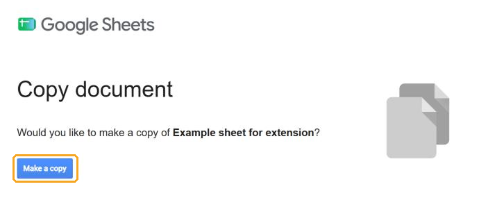
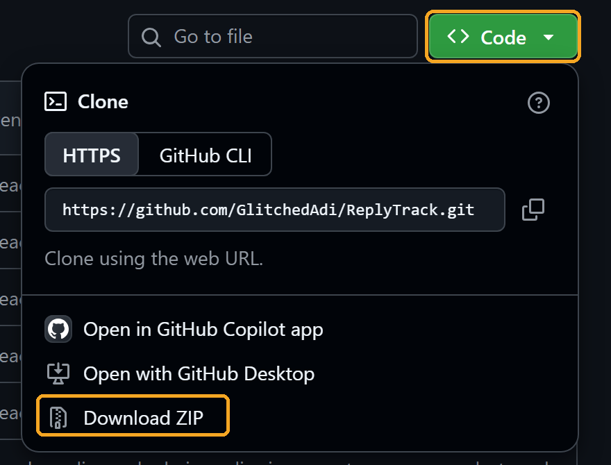
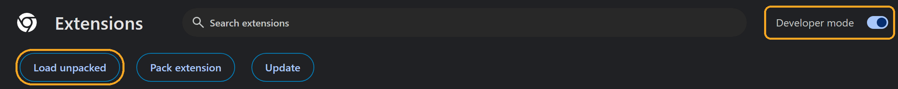
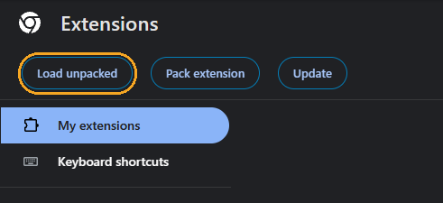
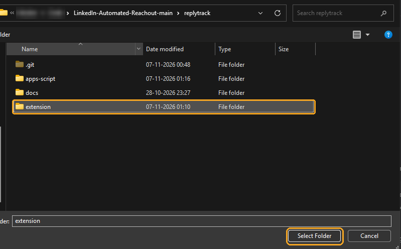
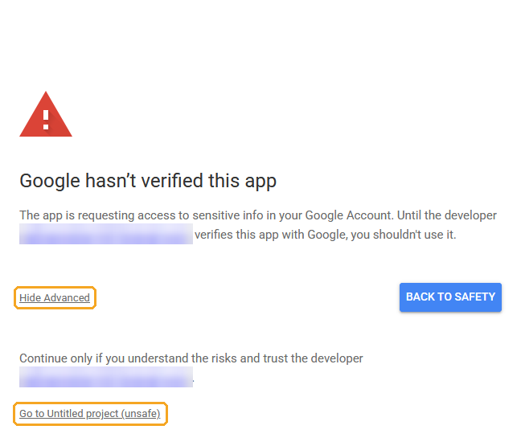
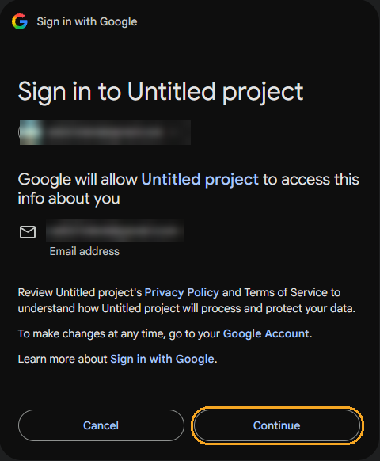
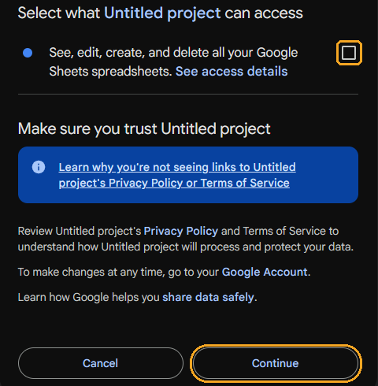
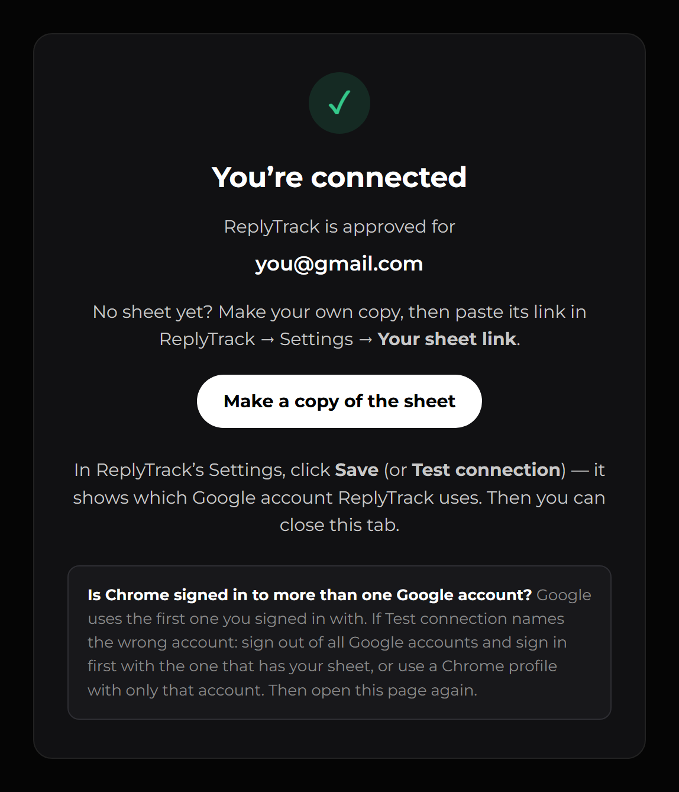
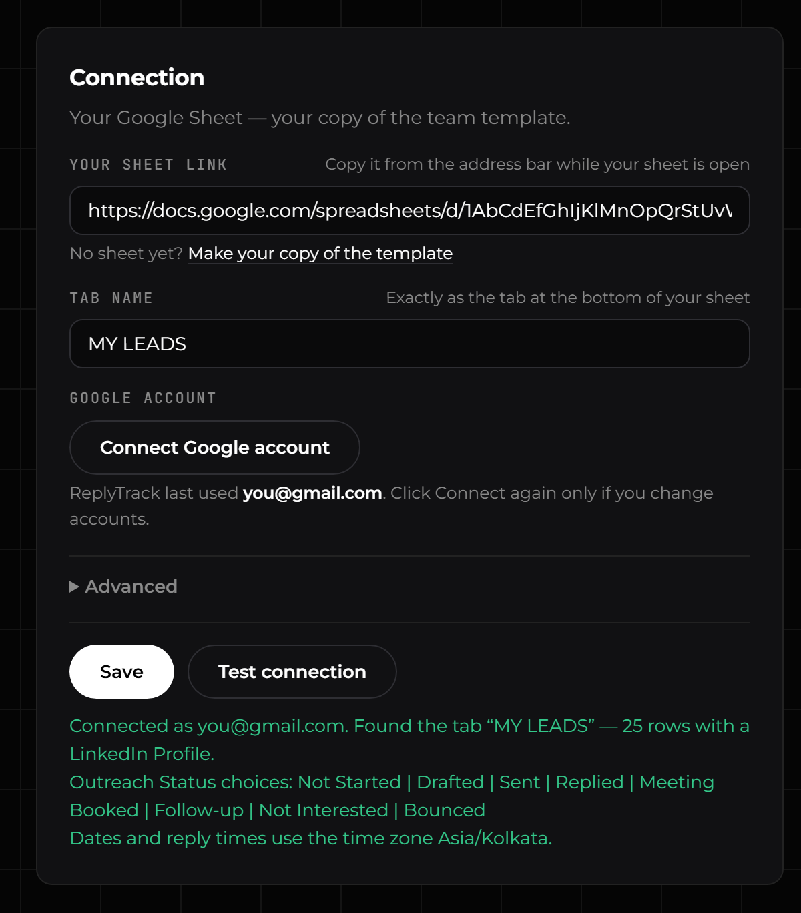

# ReplyTrack

A Chrome add-on that sends your LinkedIn connection requests from your Google Sheet and keeps the sheet up to date for you.

This page shows how to set it up on your computer. It takes about **10 minutes**.

## Contents

- [Before you start](#before-you-start)
- [Step 1 — Get your sheet](#step-1--get-your-sheet)
- [Step 2 — Install the extension](#step-2--install-the-extension)
- [Step 3 — Connect it](#step-3--connect-it)
- [Step 4 — Make it start by itself](#step-4--make-it-start-by-itself)

---

## Before you start

You need:

- A computer with **Google Chrome**.
- Your **LinkedIn** account, signed in in that Chrome.
- A **Google account** (a normal Gmail account is fine), signed in in that Chrome. Your sheet will live in this account.
- Two links from your team lead:
  - the **"Make a copy" link** of the team's sheet;
  - the **ReplyTrack page on GitHub** (GitHub is a website where the ReplyTrack files are shared).

---

## Step 1 — Get your sheet

1. Open the **"Make a copy" link** from your team lead.
2. Look at the picture at the top right of the page: it must be the Google account you want to keep your sheet in. (If it's not, click it and switch accounts.)
3. Click **Make a copy**.
   
4. Your own sheet opens. Its name starts with *Copy of …* — you can rename it by clicking the name at the top left.
5. In the **MY LEADS** tab, fill in one row per person:
   - **LinkedIn Profile** — their profile link (`https://www.linkedin.com/in/...`);
   - **Personalized Message** — the note sent with your connection request.

   Leave **Outreach Status** at **Not Started** (or empty). ReplyTrack fills in the other columns by itself. Don't rename the column names in row 1.
6. Click the address bar at the top of Chrome and copy the address of your sheet (**Ctrl+L**, then **Ctrl+C**; Mac: **Cmd+L**, **Cmd+C**). You'll paste it in Step 3.

✅ **It worked if** you have your own sheet with a **MY LEADS** tab, and its address starts with `https://docs.google.com/spreadsheets/d/`.

---

## Step 2 — Install the extension

An **extension** is a small add-on for Chrome. You'll load ReplyTrack from a folder on your computer.

1. On the ReplyTrack page on GitHub, click the green **Code** button, then **Download ZIP**.
   
2. Open your **Downloads** folder. Right-click the ZIP file and choose **Extract All…**, then **Extract**. (Mac: double-click the ZIP file.)
3. Move the new folder to a place where it can stay, for example **Documents**. Chrome loads ReplyTrack from this folder every time, so don't delete, move or rename it later.
4. Open Chrome. Type `chrome://extensions` in the address bar and press **Enter**.
5. Turn on **Developer mode** (the switch at the top right). (This lets Chrome load an add-on from a folder instead of the Chrome Web Store.)
   
6. Click **Load unpacked**.

   
7. Open the ReplyTrack folder, click the folder named **extension** inside it (it contains a file called *manifest.json*), then click **Select Folder**.
   
8. Only if you used the old **LinkedIn Automated Reachout** or the old **ReplyTrack** extension: on `chrome://extensions`, switch them **off**. Don't click **Remove** — that would delete their history.

✅ **It worked if** a dark square icon with a white arrow appears at the top right of Chrome, and the ReplyTrack dashboard opens by itself on the **Settings** tab. (No icon? Click the 🧩 puzzle piece at the top right and pin **ReplyTrack**.)

> When Chrome starts, it may show a message about developer-mode extensions. Close it with **✕** — don't click **Disable**.

---

## Step 3 — Connect it

1. Click the **ReplyTrack** icon, then **Settings** at the top.
2. In **Your sheet link**, paste the address of your sheet (from Step 1).
3. **Tab name** already says **MY LEADS**. Leave it as it is.
4. Click **Connect Google account**. A Google page opens — click **Review permissions**.
5. If Google asks you to choose an account, choose the one that has your sheet.
6. Google shows **"Google hasn't verified this app"**. **This is expected** — ReplyTrack is your team's own tool, not an app from an app store, so Google hasn't reviewed it. Click **Advanced**, then **Go to … (unsafe)**.

   
7. Google shows **"Sign in to …"**. Click **Continue**.

   
8. Google shows **"Select what … can access"**. **Tick the box** next to *See, edit, create, and delete all your Google Sheets spreadsheets* — without it, ReplyTrack can't open your sheet. Click **Continue**.
   (Google only offers this permission for all your sheets at once. ReplyTrack only ever opens the sheet whose link you pasted.)

   
9. A page says **You're connected**. Close that tab.

   
10. Back in Settings, click **Save**. ReplyTrack saves your settings and tests the connection.
11. Read the message under the buttons. It should be green and start with **Connected as** *your Google account*. Check that's the account with your sheet.

✅ **It worked if** the message says *Connected as …* with your account, the pill at the top turns green and says **Active**, and a small pinned **LinkedIn Messaging** tab appears at the far left of your Chrome tabs.

---

## Step 4 — Make it start by itself

ReplyTrack only works while Chrome is open. Set Chrome to open when your computer starts.

#### Windows

1. Press the **Windows key + R**, type `shell:startup` and press **Enter**. A folder opens.
2. Find **Google Chrome** in the Start menu, right-click it and choose **Open file location**.
3. Right-click **Google Chrome** and choose **Copy**.
4. Go back to the startup folder, right-click an empty spot and choose **Paste shortcut**.

#### Mac

1. Click the Apple menu → **System Settings → General → Login Items**.
2. Under **Open at Login**, click **+**, choose **Google Chrome** and click **Open**.

#### In Chrome (Windows and Mac)

1. Click Chrome's menu **⋮** → **Settings → On startup** → choose **Continue where you left off**. This brings the pinned LinkedIn tab back.
2. Windows only: in **Settings → System**, turn on **Continue running background apps when Google Chrome is closed**.

Keep the pinned **LinkedIn Messaging** tab open, and keep the computer on during work hours (the screen may turn off — only **sleep** stops ReplyTrack).

✅ **It worked if**, after you restart your computer, Chrome opens by itself with the pinned LinkedIn tab, and the ReplyTrack pill says **Active**.

**You're set up.** Click the ReplyTrack icon any time to open the dashboard. If something doesn't work, ask your team lead.
